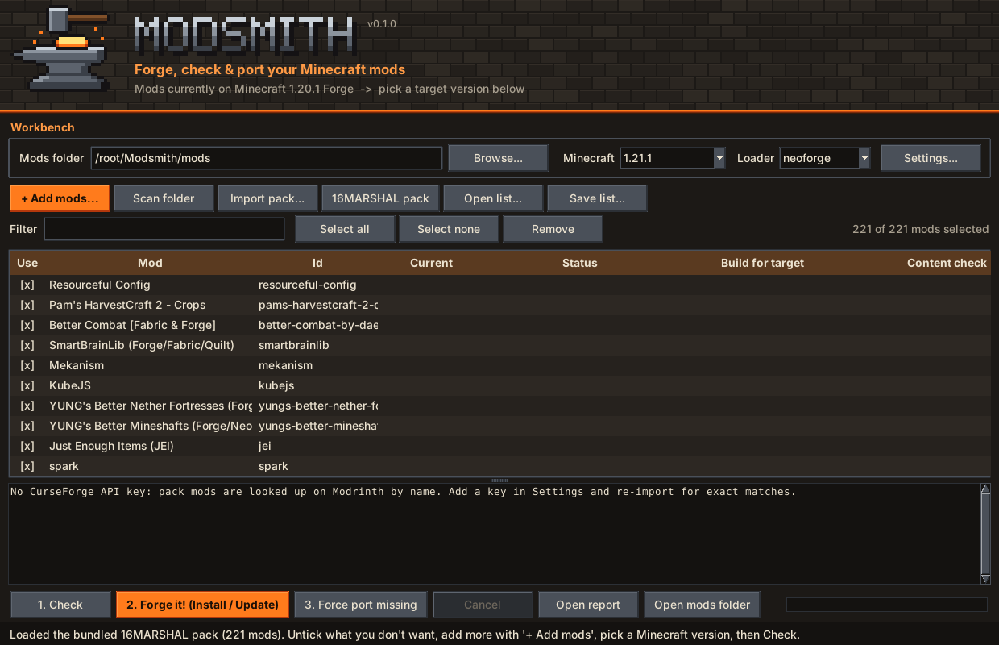
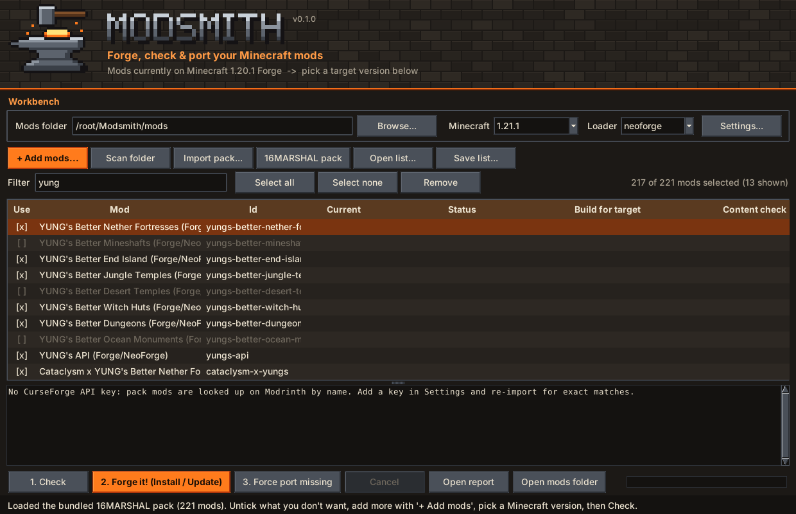
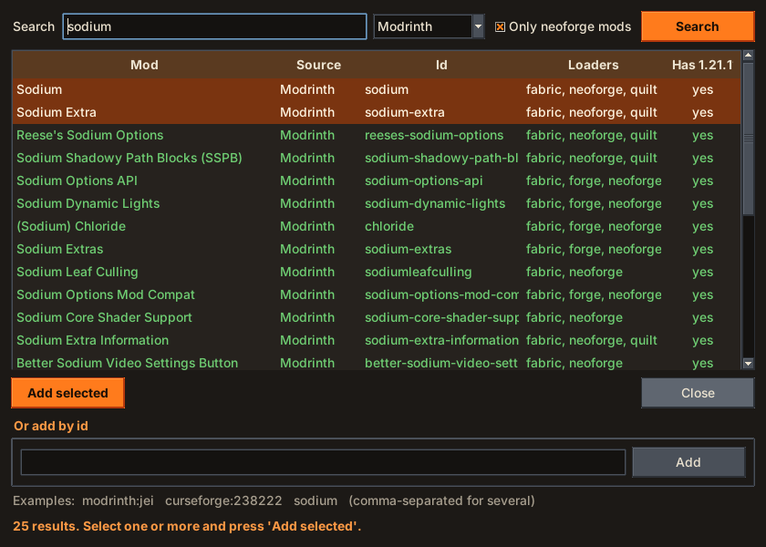
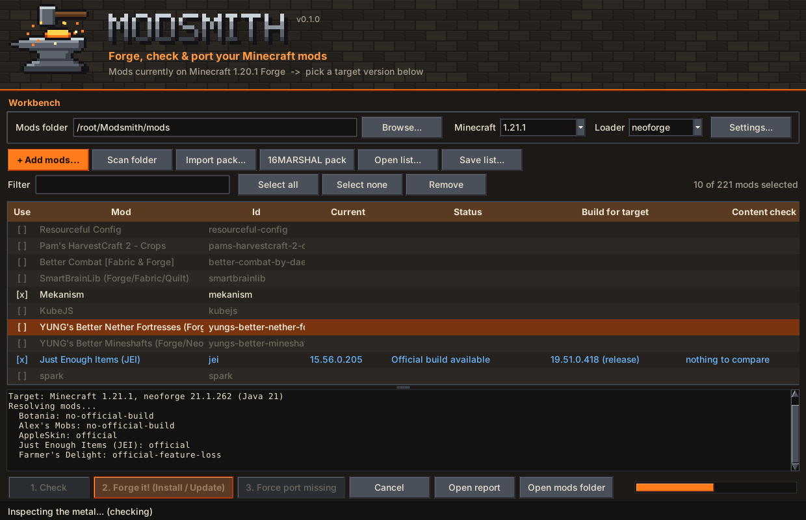
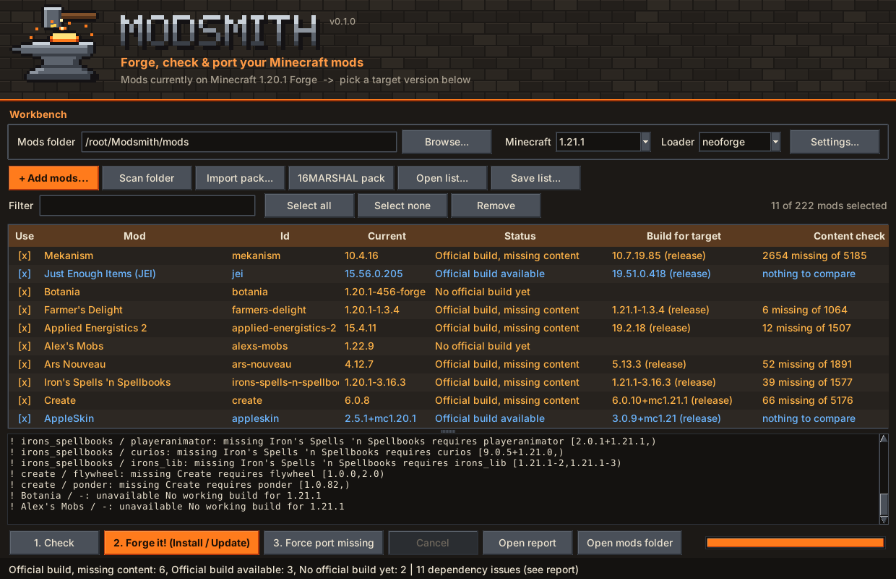
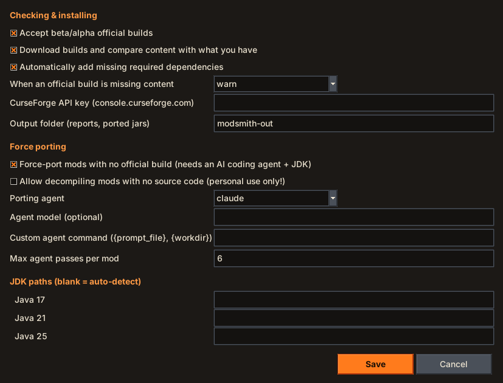

# Modded-Minecraft-2026- (16MARSHAL modpack)

A 221-mod kitchen-sink pack (Create, Mekanism, AE2, Tinkers, Ice and Fire, Alex's Mobs/Caves, Apotheosis, Iron's Spells, Ars Nouveau, Twilight Forest, Aether, and more). It includes all configs, KubeJS scripts and resource packs.

| | |
|---|---|
| Minecraft | **1.20.1** |
| Mod loader | **Forge 47.4.10** |
| Recommended RAM | 8 GB+ |
| Mods | 221 (see [MODLIST.md](MODLIST.md)) |

## ⬇️ Downloads

<table>
<tr>
<td align="center" width="50%">

### 📦 The modpack

CurseForge modpack zip · Minecraft 1.20.1 · Forge 
Import it into the CurseForge app, Prism, ATLauncher or MultiMC (see [Setup](#setup)).

</td>
<td align="center" width="50%">

### ⚒️ Modsmith app (Windows)

One file, no install, no Python needed. Double-click it. 
Comes with this pack built in, ready to update or port to any Minecraft version.

</td>
</tr>
</table>

Both files are also on the [Releases page](https://github.com/hugoneale/Modded-Minecraft-2026-/releases/latest).

> **Windows SmartScreen:** the first time you open `Modsmith.exe`, Windows may say "Windows protected your PC" because the app isn't code-signed. Click **More info**, then **Run anyway**.

## How to use Modsmith

Modsmith installs, updates and checks the mods for any Minecraft version you choose. It can also port mods that haven't been updated yet.

**1. Open it.** The 16MARSHAL pack's 221 mods are already on the workbench. Pick the **Minecraft** version and **Loader** you want at the top. The default is the latest release with NeoForge. Your **Mods folder** defaults to the Minecraft launcher's `.minecraft\mods`; use **Browse...** to choose another, such as a Prism or CurseForge instance's `mods` folder.

**2. Choose your mods.** Click `[x]` to untick a mod you don't want, or select several rows and press **Space**. Type in **Filter** to find mods in the long list. **Select all**, **Select none** and **Remove** work on what the filter shows.

**3. Add more mods.** Click **+ Add mods...**, search Modrinth (or CurseForge, with an API key in Settings) by name, select results and press **Add selected**. The *Has 1.21.1?* column shows whether a mod already has a build for your chosen version. You can also paste ids like `modrinth:jei` or `curseforge:238222`.

**4. Press "1. Check".** Nothing is changed yet. Modsmith finds the right build of every ticked mod for your version, adds missing dependencies, and downloads each build to compare its content (items, blocks, recipes, worldgen…) with the version you have now. The hammer works the anvil while it runs.

**5. Read the results.** Green or blue means there's an official build with all your content. Orange means there's a build, but some content is missing (double-click the row to see exactly what), or there's no build yet. Red means it failed or no source code was found. **Open report** shows the full table.

**6. Press "2. Forge it! (Install / Update)"** to download the builds into your mods folder. Jars being replaced are backed up to `mods\.modsmith-backup\<date>\`. **3. Force port missing** rebuilds mods that have no official build from their source code with an AI coding agent (it needs a JDK; see [modsmith/README.md](modsmith/README.md)).

**Settings** controls beta builds, the content check, automatic dependencies, your CurseForge API key (free from [console.curseforge.com](https://console.curseforge.com)) and porting.

Your mod list and settings are saved when you close the app and come back next time.

## Setup

`16MARSHALST.zip` is a CurseForge-format modpack (about 0.8 MB). It holds the manifest, configs, KubeJS scripts and resource packs. The mod `.jar` files aren't inside it: your launcher downloads them automatically from CurseForge when you import the zip.

### CurseForge app (easiest)
1. Install the [CurseForge app](https://www.curseforge.com/download/app) and open **Minecraft**.
2. Click **Create Custom Profile**, then the **import** link next to it.
3. Select `16MARSHALST.zip`. CurseForge installs Forge and all 221 mods.
4. Open the profile's settings and set allocated memory to **8 GB or more**.
5. Click **Play**.

### Prism Launcher / ATLauncher / MultiMC
1. Click **Add Instance** → **Import** (Prism: *Import from zip*).
2. Choose `16MARSHALST.zip`. The launcher reads the CurseForge manifest and downloads every mod.
3. Set max memory to 8 GB+ in the instance settings and launch.

> If a launcher reports that some mods "could not be downloaded automatically", those mod authors have disabled third-party downloads. Download each listed file from the link the launcher shows and drop it into the instance's `mods` folder.

### Dedicated server
1. Install **Forge 1.20.1-47.4.10** with the server installer from [files.minecraftforge.net](https://files.minecraftforge.net/net/minecraftforge/forge/index_1.20.1.html).
2. Copy the `mods`, `config`, `kubejs` folders from a working client instance into the server folder.
3. Remove client-only mods (for example Embeddium, Oculus, Xaero's Minimap, Mouse Tweaks, AppleSkin, Sodium/Embeddium Options and Dynamic Lights).

## Modsmith: update or port the mods to another Minecraft version

The [`modsmith/`](modsmith/) folder contains **Modsmith**, a desktop app that:
- installs and updates mods for any Minecraft version you pick
- checks for missing dependencies and version mismatches
- uses the official build when one exists, and checks that it still has all the content your version has
- otherwise **force-ports** the mod from its source code with an AI coding agent, accepting the result only if it builds and keeps every item, block, recipe and worldgen feature
- optionally (with a warning) decompiles mods that have no public source

**Windows: [download Modsmith.exe](https://github.com/hugoneale/Modded-Minecraft-2026-/releases/latest/download/Modsmith.exe)** and double-click it. It comes with this pack built in; see [How to use Modsmith](#how-to-use-modsmith).
On macOS or Linux, **[download the repository ZIP](https://github.com/hugoneale/Modded-Minecraft-2026-/archive/refs/heads/main.zip)**, unzip it, then run `modsmith/run-modsmith.bat` (Windows), `run-modsmith.command` (macOS) or `run-modsmith.sh` (Linux). See [modsmith/README.md](modsmith/README.md) for details.

To check this pack against another version, open Modsmith (the pack loads automatically, or click **16MARSHAL pack**), pick the version, then click **Check**.

## About updating to Minecraft 26.x

The latest Minecraft Java release is **26.3** (September 2026). This pack **stays on 1.20.1**, because the mods can't be forced onto 26.x:

- Mods are compiled against one specific Minecraft version and loader. Between 1.20.1 and 26.x Mojang rewrote big parts of the game code, including item data components, networking, registries and rendering. Editing a mod's version number would only make the game crash on launch.
- Most of this pack's ecosystem moved from Forge to **NeoForge**, and Forge and NeoForge mods are not interchangeable on newer versions.
- A 26.x version of the pack needs a real 26.x build of each mod: either released by its author, or ported from its source code (which is what Modsmith's force-port does). Many small add-ons and compat mods are never updated by their authors, and closed-source ones can only be decompiled for personal use.

Modsmith checks this for every mod and can port the ones that have source code available. A live check of this pack (October 2026) found official Minecraft 26.3 builds for about 57 of the 221 mods, about 137 with no 26.3 build yet, and about 30 it couldn't match without a CurseForge API key. Of the versions after 1.20.1, **1.21.1** has the widest support (about 166 of the mods).
